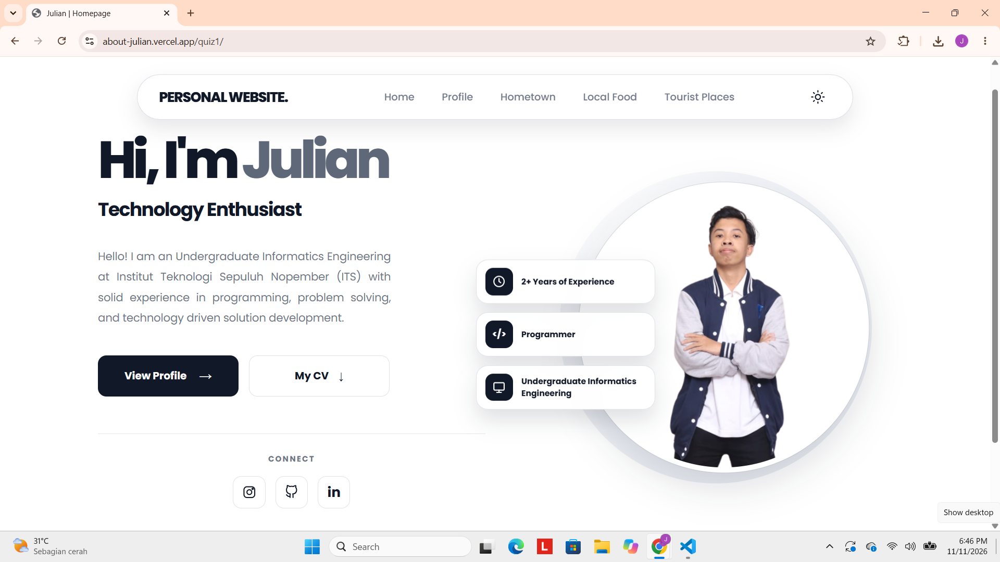
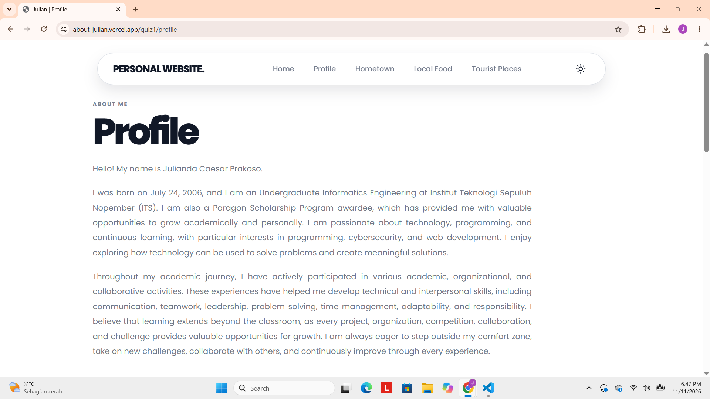
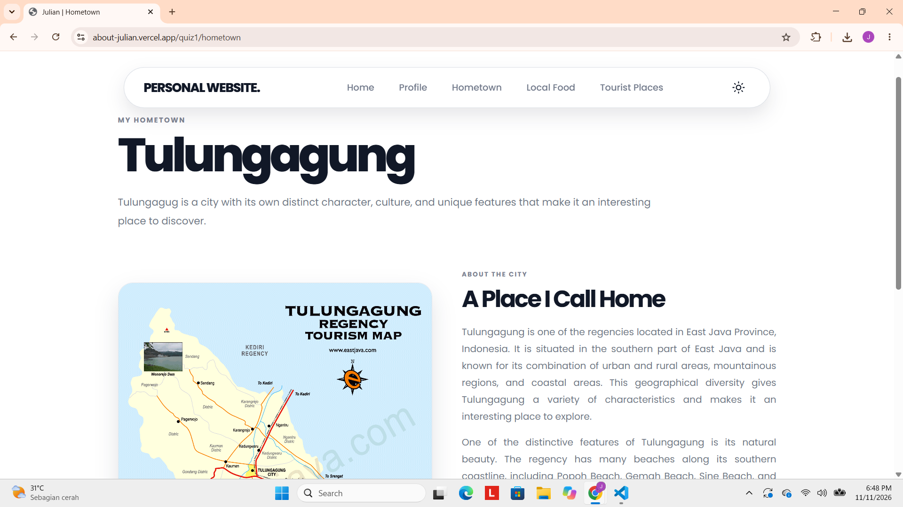
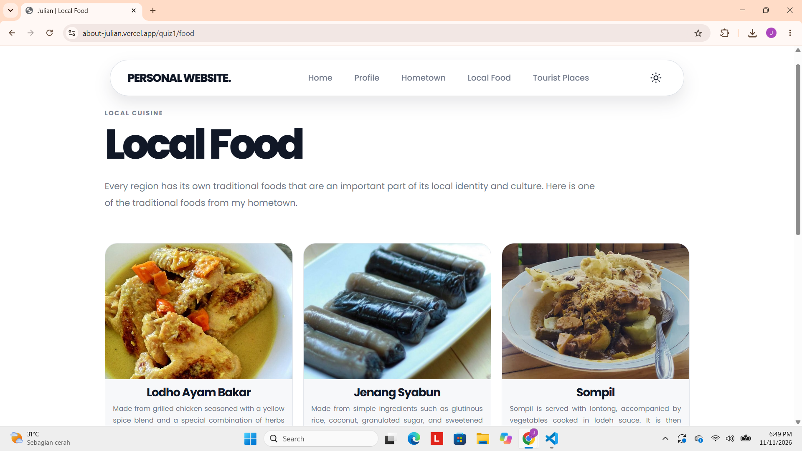
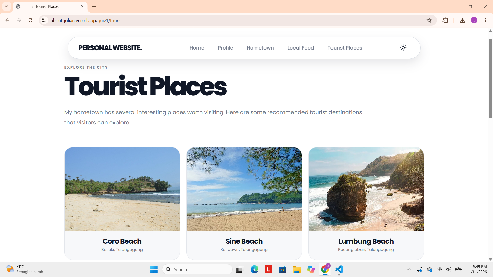

# Quiz 1 - Personal Website

## Static Website dengan HTML, CSS, dan JavaScript

## Pendahuluan

Quiz ini bertujuan untuk membangun sebuah **website personal statis** menggunakan HTML, CSS, dan JavaScript. Website berfungsi sebagai media perkenalan diri yang memuat lima bagian utama, yaitu Homepage sebagai halaman utama, Profile yang berisi informasi tentang diri saya, Hometown yang menjelaskan secara singkat kota asal saya, Local Food yang mengangkat makanan khas dari daerah asal, serta Tourist Places yang berisi panduan tempat wisata di kota asal saya.

Setiap halaman diakses melalui struktur URL (page routing) tertentu dengan awalan `/quiz1`, sebagaimana berikut:

- (Your Domain)/quiz1 untuk Homepage
- (Your Domain)/quiz1/profile untuk halaman Profile
- (Your Domain)/quiz1/hometown untuk halaman Hometown
- (Your Domain)/quiz1/food untuk halaman Local Food
- (Your Domain)/quiz1/tourist untuk halaman Tourist Places

## Link Website

Website dapat diakses melalui tautan berikut:

https://about-julian.vercel.app/quiz1

## Tampilan Website

### 1. Homepage

Homepage merupakan halaman utama (landing page) yang pertama kali dilihat pengunjung. Halaman ini berisi sambutan singkat dan pengantar tentang website, serta menjadi pusat navigasi menuju halaman Profile, Hometown, Local Food, dan Tourist Places.

### 2. Profile

Halaman Profile berisi informasi mengenai diri saya, seperti identitas, latar belakang pendidikan, minat, dan keahlian. Halaman ini bertujuan agar pengunjung dapat mengenal saya lebih dekat.

### 3. Hometown

Halaman Hometown memuat deskripsi singkat tentang kota asal saya, meliputi gambaran umum, letak geografis, serta ciri khas dan budaya daerah tersebut.

### 4. Local Food

Halaman Local Food menampilkan makanan khas dari kota asal saya. Setiap makanan disertai gambar dan penjelasan singkat mengenai ciri khas, bahan, dan cita rasanya.

### 5. Tourist Places

Halaman Tourist Places berisi panduan tempat-tempat wisata yang ada di kota asal saya. Setiap destinasi dilengkapi gambar dan deskripsi singkat sebagai referensi bagi pengunjung yang ingin berwisata ke daerah tersebut.
